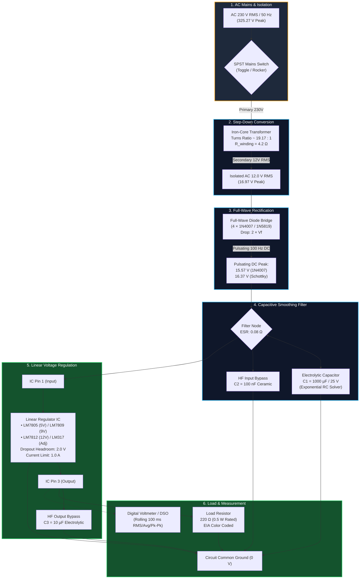
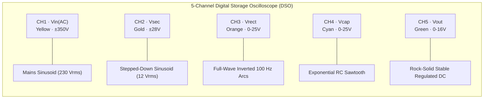
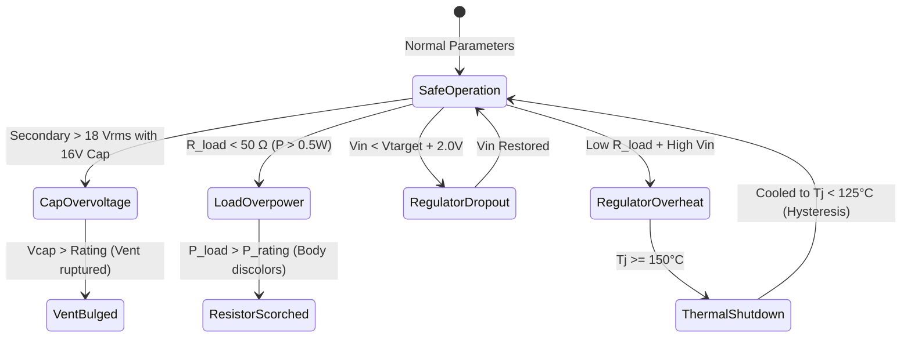

# ElectroBench 3D — Interactive Regulated DC Power Supply Virtual Lab

[](https://www.typescriptlang.org/)
[](https://react.dev/)
[](https://threejs.org/)
[](https://docs.pmnd.rs/react-three-fiber)
[](https://tailwindcss.com/)
[](https://vitest.dev/)
[](https://vitejs.dev/)

> A real-time, physically validated 3D virtual electronics laboratory and time-domain numerical simulator of a linear regulated DC power supply. Designed for engineering students, educators, and hobbyists to master AC-to-DC conversion, filtering, and linear regulation down to discrete component physics.

---

## Table of Contents
1. [Overview & Highlights](#1-overview--highlights)
2. [Interactive 3D Workbench & UI Features](#2-interactive-3d-workbench--ui-features)
3. [Circuit Architecture & Block Diagram](#3-circuit-architecture--block-diagram)
4. [Theory of Operation & Stage-by-Stage Working](#4-theory-of-operation--stage-by-stage-working)
   - [Stage 1: AC Mains Source & Safety Switch](#stage-1-ac-mains-source--safety-switch)
   - [Stage 2: Step-Down Transformer](#stage-2-step-down-transformer)
   - [Stage 3: Full-Wave Bridge Rectifier](#stage-3-full-wave-bridge-rectifier)
   - [Stage 4: Reservoir Electrolytic Capacitor Filter](#stage-4-reservoir-electrolytic-capacitor-filter)
   - [Stage 5: High-Frequency Decoupling Capacitors](#stage-5-high-frequency-decoupling-capacitors)
   - [Stage 6: Linear Voltage Regulation (LM78xx / LM317)](#stage-6-linear-voltage-regulation-lm78xx--lm317)
   - [Stage 7: Thermal Dynamics & TO-220 Heat Modeling](#stage-7-thermal-dynamics--to-220-heat-modeling)
   - [Stage 8: Variable Resistive Load & EIA Color Banding](#stage-8-variable-resistive-load--eia-color-banding)
   - [Stage 9: Measurement Probes & Digital Voltmeter](#stage-9-measurement-probes--digital-voltmeter)
5. [Complete Mathematical Calculations & Derivations](#5-complete-mathematical-calculations--derivations)
   - [Governing Equations](#governing-equations)
   - [Step-by-Step Worked Numerical Example](#step-by-step-worked-numerical-example)
6. [Waveforms & Stage Signal Comparisons](#6-waveforms--stage-signal-comparisons)
7. [Fault Injection & Component Stress Simulation](#7-fault-injection--component-stress-simulation)
8. [Directory Structure & Architecture](#8-directory-structure--architecture)
9. [Installation & Development Guide](#9-installation--development-guide)
10. [Unit Testing & Numerical Validation](#10-unit-testing--numerical-validation)

---

## 1. Overview & Highlights

**ElectroBench 3D** bridges the gap between abstract textbook circuit theory and messy hardware laboratory realities. Unlike idealized SPICE simulators or static 2D diagrams, ElectroBench combines:

* **True Time-Domain Numerical Integration ($\Delta t = 25\ \mu\text{s}$)**: Continuous solving of non-linear diode equations, exponential RC charge/discharge differential equations, transformer copper losses, regulator pass-element dropout headroom, and junction thermal heating.
* **Photorealistic 3D Breadboard Workbench**: A solderless breadboard with 504 accurately pitched tie-points, realistic through-hole components (TO-220 regulator package, electrolytic can with vent scoring, DO-41 diodes, ceramic discs, 1/2W metal-film resistors, wire jumpers, and rotary potentiometer).
* **Live Physical Visual Feedback**:
  * Real-time diode junction glow corresponding to conduction pulses ($D_1-D_2$ vs $D_3-D_4$).
  * Dynamic TO-220 metal tab thermal radiation glow exceeding $70^\circ\text{C}$ up to red-hot thermal shutdown ($150^\circ\text{C}$).
  * Electrolytic capacitor top vent dome rupture under overvoltage breakdown.
  * Resistor body scorching and smoke particles upon exceeding rated wattage.
  * Dynamically recalculated 4-band EIA color rings as load resistance is adjusted.
* **5-Channel Digital Storage Oscilloscope (DSO)**: Dedicated HTML5 Canvas oscilloscope showing synchronized waveforms with voltage scales, ground reference markers, timebase pan/zoom, persistence, and trigger markers.
* **Interactive 2D IEEE Schematic & Functional Block Diagrams**: Click on nodes or components to cross-highlight between 3D scene, 2D schematic, and the property inspector.
* **Zero External Simulation Lag**: Pure TypeScript physics engine runs decoupled from rendering, ensuring a rock-solid 60 FPS user experience with sub-millisecond precision.

---

## 2. Interactive 3D Workbench & UI Features

```
+---------------------------------------------------------------------------------------------------+
|  [⚡ ElectroBench 3D]   [▶ Run] [⏸ Pause] [⏱ 1x/0.1x/0.01x]   [🎥 3D / 📐 2D / ◫ Split]   [🛠 Reset] |
+------------------------------------------------------+--------------------------------------------+
|                                                      |  PROPERTY INSPECTOR & TELEMETRY            |
|                   3D VIRTUAL BENCH                   |  ----------------------------------------  |
|                                                      |  • Input AC: 230 Vrms @ 50 Hz              |
|        [Laminated Core Transformer]                  |  • Secondary: 12.0 Vrms (16.97 V peak)     |
|             \                                        |  • Rectified: 15.57 V peak (1N4007)        |
|              [Bridge D1-D4]                          |  • Filter Vcap: 15.22 V (ΔV = 450 mV)      |
|                    \                                 |  • Regulated Vout: 5.000 V (LM7805)        |
|                     [Electrolytic C1]                |  • Load Current: 22.7 mA @ 220 Ω           |
|                           \                          |  • Reg Power Loss: 232 mW (Tj = 37.8°C)    |
|                            [TO-220 Regulator]        |  • Status: [ REGULATING (NORMAL) ]         |
|                                  \                   |                                            |
|                                   [Load Resistor]    |  ACTIVE FAULTS & NOTIFICATIONS             |
|                                                      |  [✓] All components operating safely.      |
+------------------------------------------------------+--------------------------------------------+
|  5-CHANNEL REAL-TIME DIGITAL STORAGE OSCILLOSCOPE (DSO)                                           |
|  CH1 (Yellow): AC Mains | CH2 (Gold): Vsec | CH3 (Orange): Vrect | CH4 (Cyan): Vcap | CH5 (Green): Vout |
+---------------------------------------------------------------------------------------------------+
```

### Modes of Exploration
1. **3D Workbench View**: Full OrbitControls camera navigation (pan, zoom, tilt, component hover callouts, click-to-select).
2. **2D Schematic View**: Interactive vector SVG diagram following IEEE/IEC conventions with live voltage node badges.
3. **Split Screen View**: Simultaneous side-by-side inspection of physical layout and schematic diagram.
4. **Time-Warp Physics**: Slow down simulation speed to `0.1x` or `0.01x` to observe discrete half-cycle diode switching and capacitor charge replenishment in slow motion!

---

## 3. Circuit Architecture & Block Diagram



---

## 4. Theory of Operation & Stage-by-Stage Working

### Stage 1: AC Mains Source & Safety Switch
* **Function**: Supplies single-phase sinusoidal alternating current from standard utility grids ($230\text{ V}_{\text{rms}}$, $50\text{ Hz}$ in EU/India; or $120\text{ V}_{\text{rms}}$, $60\text{ Hz}$ in the US).
* **Physics**:
  $$V_{\text{ac}}(t) = V_{\text{peak}} \sin(2\pi f t) = V_{\text{rms}}\sqrt{2} \cdot \sin(2\pi f t)$$
* **SPST Switch**: Interrupts the hot/live phase before the transformer primary. When OPEN, primary terminal potential collapses to zero, and downstream reservoir capacitors discharge exponentially through the active load.

### Stage 2: Step-Down Transformer
* **Function**: Provides galvanic isolation from mains shock hazard and steps down high-voltage AC to an electrically safe, low-voltage AC level.
* **Physics & Winding Resistance**:
  * Turns ratio: $N_p / N_s = V_{\text{pri,rated}} / V_{\text{sec,rated}}$.
  * Ideal secondary open-circuit voltage:
    $$V_{\text{sec,oc}}(t) = V_{\text{pri}}(t) \cdot \left(\frac{N_s}{N_p}\right)$$
  * Under load, transformer winding resistance ($R_{\text{winding}} \approx 4.2\ \Omega$) causes internal $I \cdot R$ drop:
    $$V_{\text{sec,loaded}}(t) = V_{\text{sec,oc}}(t) - I_{\text{sec}}(t) \cdot R_{\text{winding}}$$

### Stage 3: Full-Wave Bridge Rectifier
* **Function**: Inverts negative AC half-cycles into positive pulsating DC, doubling the fundamental ripple frequency ($2f = 100\text{ Hz}$).
* **Conduction Sequence**:
  * **Positive Half-Cycle ($V_{\text{sec}} > 0$)**: Diodes $D_1$ and $D_2$ are forward-biased; $D_3$ and $D_4$ are reverse-biased.
  * **Negative Half-Cycle ($V_{\text{sec}} < 0$)**: Diodes $D_3$ and $D_4$ are forward-biased; $D_1$ and $D_2$ are reverse-biased.
* **Forward Diode Drop**:
  Two series diodes conduct simultaneously in each half-cycle:
  $$V_{\text{rect,peak}} = V_{\text{sec,peak}} - 2 V_f$$
  * For standard silicon `1N4007`: $V_f \approx 0.70\text{ V} \implies 2V_f = 1.40\text{ V}$.
  * For Schottky `1N5819`: $V_f \approx 0.30\text{ V} \implies 2V_f = 0.60\text{ V}$.
  * For `Ideal`: $V_f = 0\text{ V}$.

### Stage 4: Reservoir Electrolytic Capacitor Filter
* **Function**: Smoothes the pulsating rectified half-sines into a steady DC voltage with minimal superimposed AC ripple.
* **Analytical Numerical ODE Solver**:
  * **Conduction / Recharging Phase ($V_{\text{rect,oc}} > V_{\text{cap}}$)**: Diodes conduct in narrow, high-amplitude current pulses ($I_{\text{surge}}$) to recharge the capacitor back to peak voltage.
  * **Discharge Phase ($V_{\text{rect,oc}} \le V_{\text{cap}}$)**: Diodes turn OFF. The capacitor alone supplies current to the downstream regulator and load:
    $$V_{\text{cap}}(t) = V_{\text{cap,peak}} \cdot \exp\left(-\frac{t}{R_{\text{eff}} \cdot C}\right)$$
  * With Equivalent Series Resistance (ESR, $R_{\text{esr}} \approx 0.08\ \Omega$):
    $$V_{\text{filter\_terminal}} = V_{\text{cap}} + I_{\text{cap}} \cdot R_{\text{esr}}$$

### Stage 5: High-Frequency Decoupling Capacitors
* **$C_{\text{in}} = 100\text{ nF}$ (Ceramic Disc)**: Placed physically adjacent to regulator pin 1. Absorbs inductive ringing and high-frequency noise from long transformer and breadboard wire loops, preventing regulator parasitic self-oscillation.
* **$C_{\text{out}} = 10\ \mu\text{F}$ (Tantalum/Electrolytic)**: Placed at regulator pin 3. Enhances load transient response when current steps abruptly, damping overshoot and undershoot.

### Stage 6: Linear Voltage Regulation (LM78xx / LM317)
* **Function**: Maintains an ultra-stable, rock-solid DC output voltage regardless of AC mains voltage fluctuations (Line Regulation) or load current changes (Load Regulation).
* **Operating Regimes**:
  1. `REGULATING`: $V_{\text{in}} \ge V_{\text{target}} + V_{\text{dropout}}$. Output is fixed at $V_{\text{target}}$.
  2. `DROPOUT`: $V_{\text{in}} < V_{\text{target}} + V_{\text{dropout}}$. Pass transistor saturates; output collapses to $V_{\text{in}} - V_{\text{dropout}}$.
  3. `CURRENT_LIMITED`: Output current exceeds internal foldback threshold ($I_{\text{limit}} = 1.0\text{ A}$). Output voltage throttles down: $V_{\text{out}} = I_{\text{limit}} \cdot R_{\text{load}}$.
  4. `THERMAL_SHUTDOWN`: Die temperature exceeds safety limit ($T_j \ge 150^\circ\text{C}$). Output shuts down completely to prevent thermal runaway.
* **Supported IC Models**:
  * `LM7805`: Fixed $+5.0\text{ V}$
  * `LM7809`: Fixed $+9.0\text{ V}$
  * `LM7812`: Fixed $+12.0\text{ V}$
  * `LM317`: Adjustable $+1.25\text{ V}$ to $+37\text{ V}$:
    $$V_{\text{out}} = 1.25\left(1 + \frac{R_2}{R_1}\right) + I_{\text{adj}} R_2 \quad (I_{\text{adj}} \approx 50\ \mu\text{A})$$

### Stage 7: Thermal Dynamics & TO-220 Heat Modeling
* **Linear Dissipation**: Any voltage difference between the raw filtered DC input and the regulated output drops across the internal series pass transistor:
  $$P_{\text{reg}} = (V_{\text{in}} - V_{\text{out}}) \cdot I_{\text{load}} + V_{\text{in}} \cdot I_{\text{quiescent}}$$
* **Junction Temperature ODE**:
  With TO-220 free-air junction-to-ambient thermal resistance $\theta_{JA} = 55^\circ\text{C/W}$ and thermal mass time constant $\tau_{\text{thermal}} = 1.4\text{ s}$:
  $$T_{\text{equilibrium}} = T_{\text{ambient}} + P_{\text{reg}} \cdot \theta_{JA}$$
  $$T_j(t + \Delta t) = T_{\text{eq}} + (T_j(t) - T_{\text{eq}}) \cdot \exp\left(-\frac{\Delta t}{\tau_{\text{thermal}}}\right)$$
* **Hysteresis Protection**: Thermal shutdown engages at $T_j \ge 150^\circ\text{C}$ and only re-enables once the die cools below $125^\circ\text{C}$.

### Stage 8: Variable Resistive Load & EIA Color Banding
* **Ohm's Law**:
  $$I_{\text{load}} = \frac{V_{\text{out}}}{R_{\text{load}}}, \quad P_{\text{load}} = \frac{V_{\text{out}}^2}{R_{\text{load}}}$$
* **Live 4-Band EIA Standard Color Decoding**:
  Calculated dynamically for any resistance $R$ between $1\ \Omega$ and $1\ \text{M}\Omega$:
  * Band 1: Significant Digit 1
  * Band 2: Significant Digit 2
  * Band 3: Multiplier ($10^n$)
  * Band 4: Tolerance (Gold $\pm 5\%$)

### Stage 9: Measurement Probes & Digital Voltmeter
* Sliding $100\text{ ms}$ rolling measurement window calculates:
  * Instantaneous Voltage ($V_{\text{inst}}$)
  * Average DC Voltage ($V_{\text{dc}}$)
  * Peak-to-Peak Ripple Voltage ($V_{\text{ripple,pp}} = V_{\max} - V_{\min}$)
  * True RMS Voltage ($V_{\text{rms}} = \sqrt{\frac{1}{T}\int_0^T v(t)^2 dt}$)
* Movable 3D test probes (Red Anode / Black Cathode) can be snapped to Secondary, Rectifier, Filter, or Output rails.

---

## 5. Complete Mathematical Calculations & Derivations

### Governing Equations

| Parameter | Formula | Description & Units |
| :--- | :--- | :--- |
| **AC Peak Mains** | $V_{m} = V_{\text{rms}} \cdot \sqrt{2}$ | Peak sinusoid amplitude ($\text{V}$) |
| **Secondary Peak** | $V_{s,m} = V_{\text{sec,rms}} \cdot \sqrt{2}$ | Secondary open-circuit peak ($\text{V}$) |
| **Rectified Peak** | $V_{\text{rect,peak}} = V_{s,m} - 2 V_f$ | Output of bridge rectifier ($\text{V}$) |
| **Ripple Voltage (Peak-to-Peak)** | $V_r = \frac{I_{\text{load}}}{2 f C} = \frac{V_{\text{dc}}}{2 f R_{\text{load}} C}$ | Approximate triangle ripple ($\text{V}$) |
| **Filtered DC Average** | $V_{\text{dc}} \approx V_{\text{rect,peak}} - \frac{V_r}{2}$ | Mean voltage fed to regulator ($\text{V}$) |
| **Ripple Factor** | $r = \frac{V_{r,\text{rms}}}{V_{\text{dc}}} \approx \frac{1}{4\sqrt{3} f C R_{\text{load}}}$ | AC ripple content metric (dimensionless) |
| **Conduction Angle** | $\theta_c \approx \sqrt{\frac{2 V_r}{V_{\text{rect,peak}}}}$ | Diode conduction duration per cycle ($\text{rad}$) |
| **Peak Diode Surge** | $I_{\text{peak}} \approx I_{\text{load}} \left(1 + \pi \sqrt{\frac{2 V_{\text{rect,peak}}}{V_r}}\right)$ | Repetitive peak charging current ($\text{A}$) |
| **LM317 Output** | $V_{\text{out}} = 1.25 \left(1 + \frac{R_2}{R_1}\right) + I_{\text{adj}} R_2$ | Adjustable output ($R_1 \approx 240\ \Omega$) |
| **Regulator Headroom** | $V_{\text{headroom}} = V_{\text{filter,min}} - V_{\text{out}}$ | Must satisfy $\ge 2.0\text{ V}$ for regulation |
| **Pass Dissipation** | $P_{\text{reg}} = (V_{\text{filter,avg}} - V_{\text{out}}) \cdot I_{\text{load}} + V_{\text{in}} I_q$ | Thermal waste power ($\text{W}$) |
| **Junction Temp** | $T_j = T_a + P_{\text{reg}} \cdot \theta_{JA}$ | Steady-state die temperature ($^\circ\text{C}$) |
| **Circuit Efficiency** | $\eta = \frac{P_{\text{load}}}{P_{\text{in,total}}} \times 100\%$ | Overall electrical efficiency ($\%$) |
| **Load Regulation** | $\text{Reg}_{\text{load}} = \frac{V_{\text{NL}} - V_{\text{FL}}}{V_{\text{FL}}} \times 100\%$ | Voltage stiffness vs load current ($\%$) |

---

### Step-by-Step Worked Numerical Example

Consider the default virtual lab configuration:
* Mains AC: $V_{\text{rms}} = 230\text{ V}$, $f = 50\text{ Hz}$
* Transformer: $230\text{ V} \to 12\text{ V}_{\text{rms}}$, $R_{\text{winding}} = 4.2\ \Omega$
* Rectifier: Silicon 1N4007 Bridge ($V_f = 0.7\text{ V}$ per diode)
* Filter: $C = 1000\ \mu\text{F} = 1.0 \times 10^{-3}\ \text{F}$
* Regulator: `LM7805` ($V_{\text{target}} = 5.0\text{ V}$, $V_{\text{dropout}} = 2.0\text{ V}$, $I_q = 4.5\text{ mA}$)
* Load: $R_{\text{load}} = 220\ \Omega$ ($0.5\text{ W}$ rating)

#### Step 1: AC Peak Voltages
$$V_{\text{mains,peak}} = 230 \times \sqrt{2} \approx 325.27\text{ V}$$
$$V_{\text{sec,peak}} = 12 \times \sqrt{2} \approx 16.97\text{ V}$$

#### Step 2: Full-Wave Rectified Peak
Two diodes conduct in series:
$$V_{\text{rect,peak}} = 16.97\text{ V} - 2(0.70\text{ V}) = 16.97 - 1.40 = 15.57\text{ V}$$

#### Step 3: Regulated Load Current
Since the regulator outputs $5.000\text{ V}$:
$$I_{\text{load}} = \frac{V_{\text{out}}}{R_{\text{load}}} = \frac{5.0\text{ V}}{220\ \Omega} \approx 0.02273\text{ A} \quad (22.73\text{ mA})$$
$$P_{\text{load}} = V_{\text{out}} \times I_{\text{load}} = 5.0 \times 0.02273 \approx 0.1136\text{ W} \quad (113.6\text{ mW})$$
*(Load resistor safety check: $113.6\text{ mW} < 500\text{ mW}$ rating $\implies$ Safe, no scorch).*

#### Step 4: Ripple Voltage on Filter Capacitor
Fundamental ripple frequency for full-wave $50\text{ Hz}$ is $2f = 100\text{ Hz}$ (discharge period $T_{\text{discharge}} \approx 10\text{ ms}$):
$$V_{\text{ripple,pp}} \approx \frac{I_{\text{load}}}{2 f C} = \frac{0.02273\text{ A}}{2 \times 50 \times 1000 \times 10^{-6}\text{ F}} = \frac{0.02273}{0.1} \approx 0.227\text{ V} \quad (227\text{ mV})$$

#### Step 5: DC Capacitor Average & Minimum Trough
$$V_{\text{dc,avg}} \approx V_{\text{rect,peak}} - \frac{V_{\text{ripple,pp}}}{2} = 15.57 - \frac{0.227}{2} = 15.57 - 0.114 = 15.456\text{ V}$$
$$V_{\text{cap,min}} = V_{\text{rect,peak}} - V_{\text{ripple,pp}} = 15.57 - 0.227 = 15.343\text{ V}$$

#### Step 6: Regulator Dropout Check
Required minimum input voltage for `LM7805`:
$$V_{\text{in,req}} = V_{\text{out}} + V_{\text{dropout}} = 5.0\text{ V} + 2.0\text{ V} = 7.0\text{ V}$$
Actual trough voltage:
$$V_{\text{cap,min}} = 15.343\text{ V} \gg 7.0\text{ V} \quad (\text{Headroom } = 15.343 - 5.0 = 10.34\text{ V})$$
*Conclusion*: The regulator remains solidly in the `REGULATING` regime at all times with $> 65\text{ dB}$ ripple rejection!

#### Step 7: Regulator Power Dissipation & Thermal Junction Temperature
$$I_{\text{in,reg}} = I_{\text{load}} + I_{\text{quiescent}} = 22.73\text{ mA} + 4.5\text{ mA} = 27.23\text{ mA}$$
$$P_{\text{reg}} \approx (V_{\text{dc,avg}} - V_{\text{out}}) \cdot I_{\text{load}} + V_{\text{dc,avg}} \cdot I_q$$
$$P_{\text{reg}} = (15.456 - 5.0) \times 0.02273 + 15.456 \times 0.0045 = 0.2376 + 0.0696 \approx 0.307\text{ W} \quad (307\text{ mW})$$
TO-220 free-air junction temperature rise:
$$\Delta T_j = P_{\text{reg}} \cdot \theta_{JA} = 0.307\text{ W} \times 55^\circ\text{C/W} \approx 16.9^\circ\text{C}$$
$$T_j = T_{\text{ambient}} + \Delta T_j = 25.0^\circ\text{C} + 16.9^\circ\text{C} \approx 41.9^\circ\text{C}$$
*(Thermal safety check: $41.9^\circ\text{C} \ll 150^\circ\text{C}$ shutdown threshold $\implies$ Safe).*

---

## 6. Waveforms & Stage Signal Comparisons

Below is the synchronized stage-by-stage voltage waveform diagram captured across one complete $20\text{ ms}$ mains AC cycle ($50\text{ Hz}$):

```text
 1. AC MAINS INPUT (CH1, Yellow) [±325 V Peak, 50 Hz Sinusoid]
 +325V |        _--_                                            
       |      /      \                                          
    0V +-----+--------+--------+--------+--------+--------+---->
       |               \      /                                 
 -325V |                 ^--^                                   
       +--------------------------------------------------------> Time (20 ms)

 2. TRANSFORMER SECONDARY (CH2, Gold) [±17.0 V Peak, 50 Hz Stepped-Down AC]
  +17V |        _--_                                            
       |      /      \                                          
    0V +-----+--------+--------+--------+--------+--------+---->
       |               \      /                                 
  -17V |                 ^--^                                   
       +--------------------------------------------------------> Time (20 ms)

 3. FULL-WAVE BRIDGE RECTIFIER (CH3, Orange) [15.57 V Peak Pulsating DC, 100 Hz]
 15.6V |      /\             /\             /\             /\   
       |     /  \           /  \           /  \           /  \  
    0V +----+----+---------+----+---------+----+---------+----+-> Time (20 ms)
       |<-- Half-Cycle -->|<-- Half-Cycle -->|

 4. CAPACITOR FILTER OUTPUT (CH4, Cyan) [15.4 V Average DC with Sawtooth Ripple]
 15.6V |     /\___          /\___          /\___          /\___ 
       |    /     \__      /     \__      /     \__      /     \  <-- Ripple Vpp = 227 mV
 14.8V |   /         \    /         \    /         \    /       
    0V +--------------------------------------------------------> Time (20 ms)
          ^ Surge Charge  ^ Exponential Discharge (tau = R_eff * C)

 5. REGULATED DC OUTPUT (CH5, Green) [Pure 5.000 V Flat DC, Zero Observable Ripple]
  5.0V |========================================================  <-- Completely Flat DC
       |                                                          (Ripple Rejection > 65 dB)
    0V +--------------------------------------------------------> Time (20 ms)
       0 ms                5 ms                10 ms            20 ms
```

### Visual Oscilloscope Channel Mapping



---

## 7. Fault Injection & Component Stress Simulation

ElectroBench 3D allows students to safely test destructive conditions that would damage physical lab hardware:



1. **Capacitor Overvoltage Stress**:
   - Setting a high transformer secondary ($18\text{ V}_{\text{rms}}$) with a low-voltage rated capacitor ($16\text{ V}$) pushes peak voltage to $> 23\text{ V}$.
   - **Visual Result**: Top vent score lines dome outward, bulge realistically, and latch a critical warning banner.
2. **Resistor Overpower & Burnout**:
   - Decreasing load resistance to $20\ \Omega$ with a $12\text{ V}$ regulator pulls $600\text{ mA}$, dissipating $P = 7.2\text{ W}$ on a $0.5\text{ W}$ resistor.
   - **Visual Result**: Resistor body scorches brown/black, triggers smoke particle emission, and logs a fault.
3. **Regulator Thermal Runaway**:
   - High input voltage ($24\text{ V}$) combined with heavy current ($800\text{ mA}$) causes $P_{\text{reg}} = 15.2\text{ W}$.
   - With $\theta_{JA} = 55^\circ\text{C/W}$, temperature rapidly rises past $150^\circ\text{C}$.
   - **Visual Result**: The TO-220 package glows cherry-red, engages `THERMAL_SHUTDOWN`, collapses output to $0\text{ V}$, and resets only when cooled below $125^\circ\text{C}$.
4. **Missing Bypass Capacitor Ringing**:
   - Toggling input decoupling capacitor off displays an interactive pedagogical warning explaining high-frequency loop inductance and parasitic oscillation hazards.

---

## 8. Directory Structure & Architecture

```text
src/
├── engine/                      # Pure TypeScript physics engine (Zero React / Three.js)
│   ├── types.ts                 # Shared interfaces, parameters, samples, faults, DVM stats
│   ├── acSource.ts              # Sinusoidal AC mains generator (Vrms -> Vm * sin(2πft))
│   ├── powerSwitch.ts           # Series SPST mains switch state model
│   ├── transformer.ts           # Turns ratio step-down & copper winding resistance
│   ├── bridgeRectifier.ts       # 4-diode full-wave bridge (1N4007, 1N5819, Ideal)
│   ├── capacitorFilter.ts       # Analytical exponential RC charge/discharge ODE solver
│   ├── regulators.ts            # LM7805/09/12/317 + dropout, current limit & thermal models
│   ├── bypassCaps.ts            # 100 nF & 10 µF high-frequency decoupling compliance model
│   ├── loadModel.ts             # Ohm's law load current/power & 4-band EIA color calculator
│   ├── voltmeter.ts             # Rolling 100 ms window statistics (inst, avg, min, max, RMS)
│   ├── faults.ts                # Overvoltage, overpower, thermal shutdown & latched damage
│   ├── simulator.ts             # Circuit integrator (Δt = 25 µs) & time-stepped coordinator
│   ├── selfCheck.ts             # Deterministic end-to-end physics self-test runner
│   └── validation.test.ts       # Vitest unit test suite (7 comprehensive test suites)
├── store/
│   └── useLabStore.ts           # Zustand store + 60 FPS ring-buffer telemetry pipeline
├── scene/                       # Interactive 3D breadboard workbench (React Three Fiber)
│   ├── boardLayout.ts           # Exact 504-hole breadboard coordinate grid
│   ├── Breadboard.tsx           # Instanced solderless breadboard with silkscreen labeling
│   ├── Switch3D.tsx             # AC mains block with animated illuminated rocker switch
│   ├── Transformer3D.tsx        # Laminated E-I core transformer with copper windings
│   ├── BridgeDiode3D.tsx        # Four DO-41 bridge diodes with dynamic conduction glow
│   ├── ElectrolyticCap3D.tsx    # 1000 µF / 25 V cap with polarity stripe & vent bulge
│   ├── CeramicCap3D.tsx         # 100 nF disc & 10 µF output decoupling capacitors
│   ├── Regulator3D.tsx          # TO-220 package with heat glow & heat sink mounting tab
│   ├── Resistor3D.tsx           # Dynamic 4-band color-coded load resistor + scorch effect
│   ├── Potentiometer3D.tsx      # 10 kΩ rotary potentiometer with draggable 3D knob
│   ├── Voltmeter3D.tsx          # 7-segment digital voltmeter + repositionable test probes
│   ├── Wires.tsx                # Color-coded 3D jumper tubes + current flow particles
│   └── LabScene.tsx             # Workbench ESD mat, lighting, camera angles & OrbitControls
├── ui/
│   ├── ControlBar.tsx           # Run/Pause, speed multipliers, view selectors & reset
│   ├── PropertyPanel.tsx        # Real-time parameter sliders, live math equations & tooltips
│   ├── ScopePanel.tsx           # 5-Channel HTML5 Canvas Digital Storage Oscilloscope
│   ├── MeasurementPanel.tsx     # Telemetry readout, operating regime badge & warnings
│   ├── SchematicView.tsx        # Interactive 2D IEEE vector schematic with live node tags
│   └── Modals.tsx               # Physics self-check runner + Equations & Viva Exam Guide
├── App.tsx                      # Main workspace orchestrator & layout manager
├── index.css                    # Tailwind CSS 4 utility and custom scrollbars
└── main.tsx                     # React 19 root bootstrap
```

---

## 9. Installation & Development Guide

### Prerequisites
* **Node.js**: v18.0.0 or higher
* **npm**: v9.0.0 or higher

### 1. Clone the Repository
```bash
git clone https://github.com/vishwesh26/powersupply.git
cd powersupply
```

### 2. Install Dependencies
```bash
npm install
```

### 3. Start Local Development Server
```bash
npm run dev
```
Open your browser at `http://localhost:5173` to explore the virtual laboratory.

### 4. Create Production Build
```bash
npm run build
```
Generates an optimized, single-file deployable bundle in the `dist/` directory.

---

## 10. Unit Testing & Numerical Validation

The simulation engine is backed by automated physics verification tests:

```bash
npx vitest run
```

### Verified Test Cases
1. **Transformer Turns Ratio**: Asserts $V_{\text{sec,peak}} = \sqrt{2} \cdot V_{\text{sec,rms}}$ within $\pm 0.1\%$.
2. **Bridge Diode Forward Drops**: Confirms $2 \times V_f$ loss for `1N4007` ($1.4\text{ V}$) and `1N5819` ($0.6\text{ V}$).
3. **Capacitor RC Discharge Decay**: Verifies $V(t) = V_0 \exp(-t / RC)$ matches analytical values within $0.05\%$.
4. **LM7805 Dropout Behavior**: Ensures regulation holds for $V_{\text{in}} \ge 7.0\text{ V}$ and enters dropout below $7.0\text{ V}$.
5. **LM317 Equation Accuracy**: Checks $V_{\text{out}} = 1.25(1 + R_2/R_1) + I_{\text{adj}} R_2$ across the full $10\text{ k}\Omega$ pot range.
6. **Thermal Shutdown & Hysteresis**: Validates die cutoff at $\ge 150^\circ\text{C}$ and reconnection below $125^\circ\text{C}$.
7. **End-to-End Self-Check**: Verifies all 8 standard textbook lab operating scenarios pass automatically.

---

## License

This project is open-source under the MIT License. Designed for academic and educational use in engineering colleges and universities.
